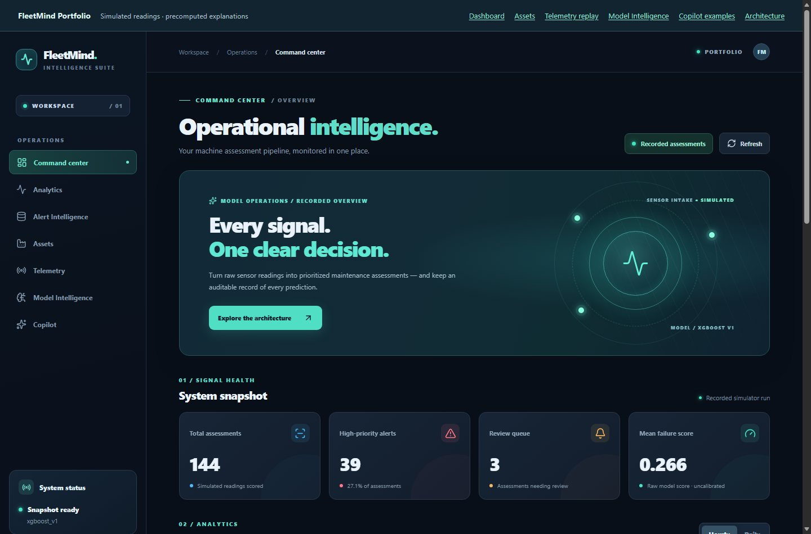

# FleetMind

**From sensor readings to evidence a maintenance reviewer can inspect.**

FleetMind is an AI engineering portfolio project for machine assessment, alert investigation, and equipment monitoring. It combines a frozen XGBoost classifier, model explanations, event-driven inference, and a maintenance Copilot with cited evidence.

**Live demo** · URL pending deployment approval.

[Setup](docs/local-setup.md) · [Deployment](docs/deployment.md) · [Architecture](docs/architecture.md) · [Screenshots](docs/screenshots/README.md) · [Case study](docs/case-study.md)

## Try FleetMind

The read-only portfolio bundles fictional assets, 144 simulator assessments scored by the frozen model, precomputed SHAP, a replayable telemetry sequence, and scripted Copilot examples. It runs without a database, model provider key, or account. Optional live inference scores a selected reading without saving it.

~~~powershell
cd frontend
$env:NEXT_PUBLIC_FLEETMIND_MODE = 'portfolio'
npm.cmd ci
npm.cmd run dev -- --hostname 127.0.0.1
~~~

Open `http://127.0.0.1:3000`. To use authenticated asset management, provider-backed Copilot, telemetry ingestion or observability, follow [full local setup](docs/local-setup.md).

## System at a glance

~~~mermaid
flowchart LR
  Browser["Next.js operations workspace"] --> API["FastAPI and role checks"]
  Producer["Seeded sensor producer"] --> Broker["Redpanda"] --> Worker["Inference worker"]
  API --> Model["Frozen XGBoost and TreeSHAP"]
  Worker --> Model
  Worker --> DB[("PostgreSQL and pgvector")]
  API --> DB
  DB -->|Committed SSE| Browser
  API --> Copilot["Hybrid retrieval and bounded Copilot"]
  API -.-> Metrics["Prometheus, Grafana and model monitoring"]
~~~

**Stack** · TypeScript, Next.js, React, Recharts, FastAPI, SQLAlchemy, PostgreSQL 17, pgvector, Alembic, XGBoost, scikit-learn, SHAP, Redpanda, Prometheus, Grafana, and optional MLflow.

- **Investigations** · Filter alert history, inspect the original six inputs, and open model-version-checked SHAP contributions for individual predictions.
- **Knowledge and Copilot** · Combine vector and full-text search with Reciprocal Rank Fusion. A bounded orchestrator calls typed read-only tools, checks evidence, and can abstain.
- **Distributed telemetry** · Validate and score versioned events. Acknowledge durable processing after the database commit and deduplicate retries by source event ID. The frontend streams committed assessments.
- **Security and MLOps** · Argon2id sign-in, scoped sessions, CSRF checks, role enforcement, conversation ownership, frozen artifact integrity, training lineage, and private model and platform monitoring.

## Measured results

| Study | Result |
| --- | --- |
| Held-out AI4I evaluation | Average precision **0.8655**. At threshold **0.50**, recall **0.8676**, precision **0.5842**, F1 **0.6982**. [Report](reports/final_test_metrics.json) |
| Paired two-worker local telemetry | **41.6 committed assessments/s**, **6.38 s p95** observation to commit at the recorded workload. [Benchmark](reports/telemetry_worker_scaling_m11b.json) |
| Paired desktop browser recording | Long tasks **8 → 1** with a higher sampled heap of **9.92 → 17.07 MiB**. [Method and reports](docs/mlops.md) |
| Scripted Copilot regression | **51 cases passed**, covering tool selection, evidence checks, and answer or abstention behavior. [Report](reports/copilot_scripted_m11b.json) |

The AI4I dataset contains **10,000 synthetic observations** with **3.39%** failure prevalence. The classifier uses a stratified holdout, class weighting, and a derived thermal-gap feature. Its scores are uncalibrated. FleetMind assesses a reading for a binary label and provides no validated time-to-failure estimate. SHAP explains model output in raw-margin units. Drift reports compare distributions. Neither signals causation or an independently verified equipment diagnosis. Local benchmarks characterize the reported experiments. [Model card](docs/model-card.md) · [Dataset attribution](docs/data-and-attribution.md)

## Repository navigation

| Area | Location |
| --- | --- |
| Web application and same-origin bridge | [frontend](frontend/) |
| API, database, inference, retrieval, telemetry and authorization | [src/fleetmind](src/fleetmind/) |
| Database revisions and optional infrastructure | [migrations](migrations/) · [ops](ops/) |
| Modeling, evaluation and validation | [notebooks](notebooks/) · [reports](reports/) · [tests](tests/) |
| Documentation and release notes | [Documentation index](docs/index.md) · [Contributing and tests](CONTRIBUTING.md) · [Security](SECURITY.md) · [Changelog](CHANGELOG.md) |
