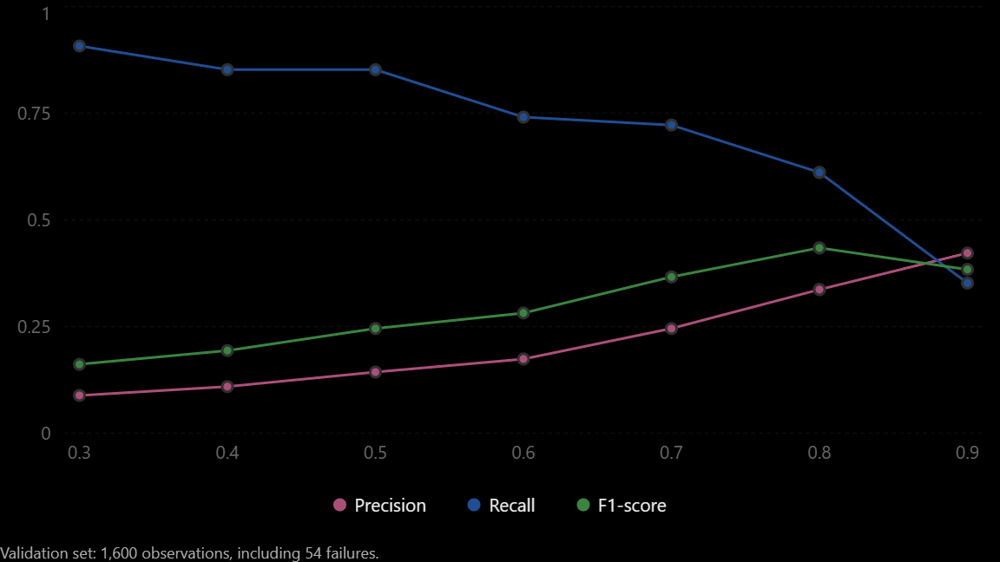

Threshold analysis shows exactly what we wanted to investigate: FleetMind can reduce false alarms substantially by raising the classification threshold, but doing so also increases missed failures.

The experiment ran successfully, and all four tests passed. Let's interpret the results before building next model.

## 1. Threshold analysis results

Three thresholds are particularly interesting:
Threshold	Detected failures	False alarms	Missed failures
0.5	46	275	8
0.7	39	120	15
0.8	33	65	21

At 0.7, false alarms decrease from 275 to 120, a reduction of approximately 56%, while the model still detects 39 of 54 failures.

At 0.8, F1 reaches its highest value among the seven thresholds tested, but recall falls to 61.1%.

I shouldn't select 0.8 just because it maximizes F1 on this validation sample. A maintenance system may value avoiding missed failures more than reducing alerts, and we'll eventually need an explicit operating objective.